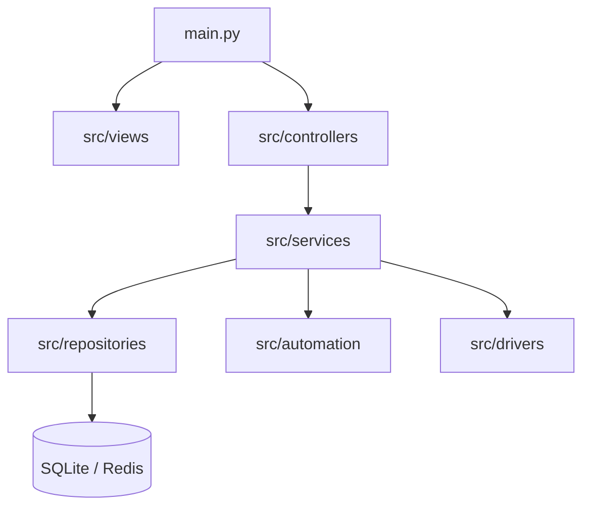

# Báo cáo Phân tích Dự án: phonemanager_v3 (PhoneFarm Management)

Dự án **phonemanager_v3** là một hệ thống quản lý, giám sát và tự động hóa điều khiển nhiều thiết bị Android (PhoneFarm) trên nền tảng máy tính (Desktop GUI) được phát triển bằng ngôn ngữ Python.

Hệ thống được thiết kế theo kiến trúc phân lớp rõ ràng (MVC-Repository & Service Layer) kết hợp với các luồng công việc chạy ngầm (background workers) để tương tác đồng thời với nhiều thiết bị mà không làm khóa giao diện người dùng.

---

## 1. Công nghệ & Thư viện sử dụng (Tech Stack)

### Giao diện và Đa luồng (GUI & Concurrency)
- **PySide6 (Qt for Python):** Dùng để thiết kế giao diện đồ họa chuyên nghiệp (MainWindow, Sidebar, Pages, Tables, Dialogs) và quản lý luồng bằng `QThreadPool`, `QRunnable` và hệ thống Signal/Slot của Qt giúp truyền tin hiệu quả giữa luồng giao diện và luồng chạy nền.

### Cơ sở dữ liệu và Quản lý trạng thái (Database & State Management)
- **SQLite (QSqlDatabase):** Cơ sở dữ liệu cục bộ dùng để lưu trữ thông tin thiết bị, tài khoản mạng xã hội, proxy. Kết nối được thiết kế an toàn đa luồng (Thread-safe: mỗi thread một connection riêng) và cấu hình chế độ **WAL (Write-Ahead Logging)** để tối ưu hiệu năng ghi đọc.
- **Redis (RedisStateFacade):** Đóng vai trò là bộ nhớ cache phân tán để lưu trữ trạng thái chạy thực tế (runtime status) như danh sách job đang chờ/chạy, trạng thái online/offline của thiết bị, phân phối proxy động cho thiết bị.

### Tương tác và Điều khiển thiết bị (Device Control & Mirroring)
- **adbutils:** Thư viện Python giao tiếp với ADB (Android Debug Bridge), quản lý kết nối thiết bị và chạy lệnh shell.
- **uiautomator2:** Thư viện điều khiển giao diện Android bằng cách phân tích cấu trúc cây layout (XML) và thực hiện các thao tác giả lập click, scroll, nhập liệu, xử lý popup tự động qua Xpath.
- **scrcpy:** Hỗ trợ truyền hình ảnh màn hình điện thoại lên PC dưới dạng lưới (Grid Layout) để người vận hành dễ dàng theo dõi trực quan các máy điện thoại đang chạy tự động.

### Quản lý mạng và Proxy (Networking & Proxy)
- **Gnirehtet:** Giải pháp Reverse Tethering giúp các thiết bị Android sử dụng kết nối mạng internet của máy tính thông qua cáp USB dưới dạng một kết nối VPN giả lập.
- **Redsocks2 & Iptables:** Chuyển hướng toàn bộ lưu lượng mạng TCP trên thiết bị Android qua các proxy chỉ định (như HTTP, SOCKS5). Quy trình này đòi hỏi thiết bị đã được **Root (su)** và thiết lập các rule tường lửa `iptables` trực tiếp.

---

## 2. Kiến trúc Thư mục và Các Thành phần Chính

Dự án được tổ chức rất khoa học tại thư mục [src](file:///Users/dinhbinhnguyen/Dev/phonemanager_v3/src):

### Chi tiết các tầng:
1. **Tầng Thực thể ([src/entities.py](file:///Users/dinhbinhnguyen/Dev/phonemanager_v3/src/entities.py)):** Định nghĩa các thực thể dữ liệu dưới dạng `@dataclass` như:
   - `Device`: Thiết bị vật lý (UUID, device_id, name, status, root status).
   - `User`: Hồ sơ người dùng Android (Multi-User) trên thiết bị.
   - `Social`: Tài khoản mạng xã hội (Facebook, TikTok) được liên kết với một User nhất định.
   - `Proxy`: Thông tin proxy (IP, port, user/pass, rotation link).
   - `Job`: Nhiệm vụ tự động hóa được phân phối cho các máy (parameters, status, action).

2. **Tầng Giao diện ([src/views](file:///Users/dinhbinhnguyen/Dev/phonemanager_v3/src/views)):**
   - [mainwindow.py](file:///Users/dinhbinhnguyen/Dev/phonemanager_v3/src/views/mainwindown.py): Khung chính tích hợp Sidebar bên trái, StackedWidget ở giữa hiển thị các Page, cột hiển thị Log thời gian thực bên phải và StatusBar ở dưới cập nhật tài nguyên hệ thống (Jobs, Devices, Proxies).
   - `pages/home/`: Trang chủ chứa các bảng quản lý thiết bị (`device_table.py`), tài khoản (`social_table.py`), hồ sơ Android (`user_table.py`).

3. **Tầng Điều khiển ([src/controllers](file:///Users/dinhbinhnguyen/Dev/phonemanager_v3/src/controllers)):**
   - Đóng vai trò là cầu nối xử lý logic từ UI xuống tầng Service. 
   - `DeviceController` chịu trách nhiệm mở `scrcpy` theo lưới, kích hoạt proxy Redsocks hoặc bật quét ADB.

4. **Tầng Dịch vụ ([src/services](file:///Users/dinhbinhnguyen/Dev/phonemanager_v3/src/services)):**
   - Thực hiện logic nghiệp vụ cốt lõi, tương tác với Repositories và Redis.
   - `DeviceService` quét và phát hiện các thiết bị kết nối/ngắt kết nối qua tín hiệu ADB.

5. **Tầng Trình điều khiển ([src/drivers](file:///Users/dinhbinhnguyen/Dev/phonemanager_v3/src/drivers)):**
   - Giao tiếp trực tiếp với phần cứng và phần mềm hệ thống: `adb`, `scrcpy`, `redis`, `redsocks`, `gnirehtet`.

6. **Tầng Tự động hóa ([src/automation](file:///Users/dinhbinhnguyen/Dev/phonemanager_v3/src/automation)):**
   - [base_automator.py](file:///Users/dinhbinhnguyen/Dev/phonemanager_v3/src/automation/core/base_automator.py): Wrapper của `uiautomator2` để cung cấp các hàm tiện ích như `launch_app`, `smart_sleep`, `click_button_with_retry`, tắt bàn phím ảo, và các watcher chạy ngầm tự động click nút "Cho phép" (Allow permissions) hoặc "Đóng" (Close popups).
   - `facebook/actions/list_marketplace_share.py`: Tự động hóa việc đăng bài bất động sản lên Facebook Marketplace bao gồm: đẩy ảnh vào máy điện thoại, điền thông tin chi tiết (Tiêu đề, Giá, Danh mục, mô tả,...), tự động chọn nhóm để chia sẻ bài viết chéo và bấm đăng.

---

## 3. Các Tính năng Đặc biệt & Cơ chế Vận hành

### A. Tận dụng tính năng Android Multi-User
- Dự án quản lý thiết bị không chỉ ở mức độ thiết bị vật lý, mà còn ở mức độ các không gian người dùng (Profiles/Users) trên thiết bị Android (ví dụ user 0 là Owner, user 10, 11... là các không gian phụ).
- Cho phép tạo người dùng mới (`pm create-user`), chuyển đổi giữa các không gian (`am switch-user`), dọn dẹp RAM sâu khi đổi người dùng.
- Cơ chế này cho phép vận hành nhiều tài khoản mạng xã hội (Facebook, TikTok) biệt lập trên cùng một thiết bị vật lý mà không bị phát hiện chéo thông tin.

### B. Định tuyến mạng cô lập qua Proxy với Redsocks2
- Để tránh việc hàng chục thiết bị cùng dùng chung một địa chỉ IP nội bộ dẫn tới việc tài khoản mạng xã hội bị khóa hàng loạt, hệ thống tích hợp `redsocks2` trực tiếp lên thiết bị Android.
- Trình điều khiển tự động phát hiện kiến trúc CPU thiết bị (ARM v7 hay v8), nạp binary tương ứng từ file cấu hình base64 vào `/data/local/tmp/redsocks2`.
- Sử dụng quyền root để kích hoạt tường lửa `iptables` chuyển hướng toàn bộ lưu lượng mạng (trừ mạng LAN nội bộ) qua cổng Redsocks nội bộ, giúp định tuyến toàn bộ traffic qua Proxy (SOCKS5/HTTP) một cách trong suốt ở tầng mạng.

### C. Giao diện scrcpy dạng lưới tự động
- File script [open_farm.py](file:///Users/dinhbinhnguyen/Dev/phonemanager_v3/open_farm.py) và logic trong `DeviceController` tự động đo độ phân giải màn hình PC hiện tại để tính toán lưới hiển thị scrcpy hợp lý nhất (ví dụ: màn hình chia thành lưới 2x3 hoặc 3x3 tùy theo số lượng máy).
- Đồng thời truyền lệnh tắt màn hình điện thoại vật lý (`--turn-screen-off`) giúp tiết kiệm pin và giảm nhiệt độ cho thiết bị khi chạy cắm cáp liên tục.

### D. Đồng bộ dữ liệu đa nền tảng
- Tệp script [sync_data.py](file:///Users/dinhbinhnguyen/Dev/phonemanager_v3/sync_data.py) cho phép đồng bộ hóa dữ liệu hình ảnh sản phẩm và cơ sở dữ liệu từ máy macOS (đóng vai trò nguồn lưu trữ) sang máy Windows (nơi cắm PhoneFarm chạy) qua kết nối SSH/SCP với thanh tiến trình trực quan (`tqdm`).

---

## 4. Nhận xét Đánh giá Hệ thống

### Điểm mạnh:
1. **Kiến trúc sạch sẽ (Clean Architecture):** Tách biệt rõ giao diện, nghiệp vụ và driver phần cứng. Code dễ bảo trì và mở rộng thêm các tính năng tự động hóa mới (ví dụ viết thêm tính năng cho TikTok hoặc Zalo rất đơn giản).
2. **Cơ chế Proxy Triệt để:** Bằng việc can thiệp bằng `iptables` kết hợp `redsocks2` thay vì cấu hình VPN/Wi-Fi proxy thông thường, các ứng dụng mạng xã hội khó phát hiện thiết bị đang chạy qua proxy hơn.
3. **Quản lý trạng thái bằng Redis tốt:** Sử dụng Redis giúp lưu thông tin tác vụ bất đồng bộ linh hoạt, tránh bị nghẽn hay xung đột ghi đè cơ sở dữ liệu SQLite cục bộ khi nhiều thiết bị gửi trạng thái về cùng một lúc.

### Khuyến nghị phát triển:
1. **Kiểm soát RAM & Nhiệt độ:** Chạy nhiều máy ảo `scrcpy` kèm chạy script tự động hóa `uiautomator2` sẽ tốn rất nhiều tài nguyên CPU của máy chủ. Cần có cơ chế cảnh báo nhiệt độ pin từ thiết bị gửi về hệ thống qua ADB.
2. **Xử lý Captcha / Checkpoint tự động:** Tự động hóa Facebook Marketplace rất dễ gặp checkpoint hoặc yêu cầu xác thực hình ảnh. Cần thiết kế thêm module tích hợp dịch vụ giải captcha bên thứ ba hoặc gửi thông báo đẩy đến Telegram/Discord khi phát hiện màn hình bị khóa checkpoint.
